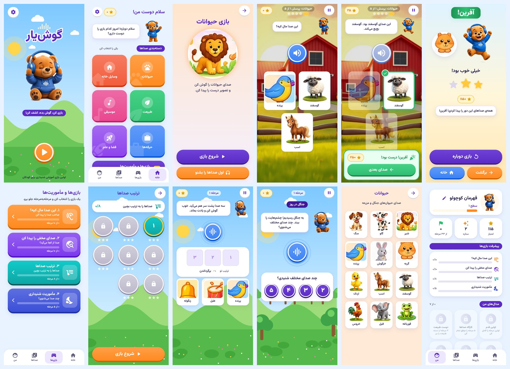

# گوش‌یار — بازی آموزشی شنیداری کودکان (Flutter)

بازی کن، گوش بده، کشف کن! برنامه‌ی اندرویدی برای کودکان ۳ تا ۸ سال که با صدای حیوان‌ها،
وسایل خانه، طبیعت، موسیقی، حرفه‌ها و فضا، مهارت شنیداری، تمرکز و حافظه را تقویت می‌کند.

این نسخه بازنویسی کامل نسخه‌ی Java (برچسب `legacy-java-7fd09f8`) با Flutter و Dart است.
گزارش مهاجرت و فهرست کامل تغییرات: [MIGRATION.md](MIGRATION.md).



*تصویرها از نسخه‌ی وب همین کد در Chromium گرفته شده‌اند (۴۱۲×۹۱۵).*

## اجرا

نیازمندی‌ها: Flutter 3.47 یا بالاتر (Dart 3.13)، Android SDK (API 36)، JDK 17.

```bash
cd goshyar_game
flutter pub get
flutter run                     # روی گوشی یا شبیه‌ساز متصل
flutter run -d chrome           # پیش‌نمایش سریع در مرورگر (بدون امکانات دانلود)
```

## ساخت خروجی

```bash
# APK برای نصب مستقیم
flutter build apk --release
# → build/app/outputs/flutter-apk/app-release.apk

# AAB برای Google Play / کافه‌بازار / مایکت
flutter build appbundle --release
# → build/app/outputs/bundle/release/app-release.aab

# با سرور دارایی‌های Cloudflare (اختیاری؛ cloudflare/README.md)
flutter build apk --release \
  --dart-define=GOSHYAR_CDN_BASE=https://assets.example.com \
  --dart-define=GOSHYAR_ASSET_VERSION=v1
```

**امضا:** `android/key.properties.example` را به `android/key.properties` کپی و پر کنید.
بدون آن، نسخه‌ی release با کلید debug امضا می‌شود که فقط برای آزمایش مناسب است.
شناسه‌ی بسته `com.goshyar.app` است (نسخه‌ی Java قبلی `ir.brandimo.goshyar` بود). چون شناسه عوض شده،
این نسخه **برنامه‌ی جدیدی** حساب می‌شود: روی نسخه‌ی قبلی به‌روزرسانی نمی‌شود، کنارش نصب می‌شود، و پیشرفت
ذخیره‌شده‌ی نسخه‌ی قبلی به آن منتقل نمی‌شود (اندروید داده‌ی هر برنامه را جدا نگه می‌دارد).

## آزمون‌ها

```bash
flutter analyze
flutter test
```

- منطق بازی، امتیاز و ستاره‌ها: `test/game_logic_test.dart`
- سلامت محتوا (هر صدا تصویر و فایل دارد، هر شناسه‌ی جمله وجود دارد، پرسش‌ها پاسخ را لو نمی‌دهند): `test/content_integrity_test.dart`
- پیشرفت، مدال‌ها، انتقال داده‌ی نسخه‌ی قدیمی: `test/progress_store_test.dart`
- دانلود، sha256 و حالت آفلاین: `test/download_manager_test.dart`
- جریان کامل صفحه‌ها و نبود سرریز در گوشی‌های ۳۲۰ تا ۸۰۰ نقطه‌ای: `test/app_flow_test.dart`

## ساختار

```
lib/
  main.dart, app.dart          راه‌اندازی، Providerها، زبان فارسی و راست‌چین
  core/design/                 سیستم طراحی: رنگ، فاصله، شعاع، سایه، حرکت، تایپوگرافی
  core/audio/                  پخش صدا: سه کانال مستقل، لغو، کاهش موسیقی هنگام گفتار
  core/assets/                 لایه‌ی مرکزی دارایی‌ها، تنظیم CDN، مدیر دانلود
  core/narrator.dart           شناسه‌ی جمله ← متن و فایل صوتی
  data/                        مدل‌ها، خواندن محتوا، پیشرفت، تنظیمات، انتقال داده‌ی قدیمی
  game/                        منطق خالص بازی (بدون رابط کاربری)
  ui/widgets/                  اجزای مشترک (دکمه، کارت، ماسکوت، صحنه، کارت گزینه…)
  ui/screens/                  صفحه‌ها
assets/
  content/levels.json          دسته‌ها، صداها، مکان‌ها، مرحله‌ها، مدال‌ها، امتیازدهی
  content/voice_lines.json     ۲۲۰ جمله‌ی گوینده با شناسه، رویداد، صفحه و فایل
  images/ audio/ fonts/        دارایی‌های داخلی (همیشه آفلاین)
android/                       پروژه‌ی اندروید (فقط MainActivity.kt برای انتقال داده‌ی قدیمی)
cloudflare/                    Worker، پیکربندی R2 و اسکریپت‌های انتشار
tools/                         آماده‌سازی دارایی‌ها، ضبط صدا، استودیوی صداگذاری، ابزارهای نسخه‌ی قدیمی
docs/voice/                    فیلم‌نامه‌ی ضبط و فهرست فایل‌ها (تولیدی)
legacy/android/                پروژه‌ی اندروید Java قبلی (بیرون از مسیر ساخت؛ برچسب legacy-java-7fd09f8)
art/source/canva/              تصویرهای منبع ساخته‌شده با Canva
```

## ویرایش محتوا بدون تغییر کد

- **مرحله‌ها و صداها:** `assets/content/levels.json`. بعد از تغییر `flutter test` را اجرا کنید؛
  تست سلامت محتوا ارجاع‌های شکسته را پیدا می‌کند.
- **جمله‌های گوینده:** `assets/content/voice_lines.json`، سپس
  `python3 tools/voice/make_recording_script.py` تا فیلم‌نامه‌ی ضبط به‌روز شود.
- **استودیوی صداگذاری** `tools/voice-studio/` (ویندوز: `start.bat`؛ بقیه: `npm install && npm start`،
  راهنما: [tools/voice-studio/README.md](tools/voice-studio/README.md)). همه‌چیز مستقیم داخل پروژه نوشته
  می‌شود و چیزی آپلود نمی‌شود:
  - صدای موقت گوینده با آواشو در `assets/audio/voice/` (ضبط انسانی را هرگز بازنویسی نمی‌کند)؛
  - جایگزینی صدای حیوان‌ها و وسایل با فایل واقعی در `assets/audio/sfx/` (منبع و مجوز در `docs/audio/sfx_sources.json`).
- **صدای ضبط‌شده:** `tools/voice/import_recordings.sh <پوشه‌ی فایل‌های استودیو>`
  (یکسان‌سازی بلندی و تبدیل به MP3 در `assets/audio/voice/`).
- **تصویرها:** `python3 tools/prepare_assets.py --legacy legacy/android`؛
  تصویر جدید Canva را با نام `sound_<id>.jpg` در `art/source/canva/` بگذارید تا جایگزین شود.

## وضعیت صدا و تصویر (صادقانه)

- **صدای گوینده:** هنوز ضبط نشده است. متن‌ها آماده‌ی ضبط‌اند (`docs/voice/RECORDING_SCRIPT.md`).
  تا آن زمان حرف‌های گوش‌یار در حباب گفت‌وگو نوشته می‌شود و بازی بی‌وقفه کار می‌کند.
- **صدای حیوان‌ها و وسایل (۴۶ فایل):** همه **ضبط واقعی** از Wikimedia Commons با مجوز آزاد (CC0، مالکیت عمومی،
  CC BY، CC BY-SA)؛ منبع، مجوز و سازنده‌ی هر فایل در `docs/audio/sfx_sources.json` (برای CC BY/BY-SA ذکر نام لازم است).
  انتخاب‌ها در `tools/sfx/picks.json`، ساخت دوباره با `python3 tools/sfx/fetch_sounds.py`. هر کدام خوب نبود، در
  تب «صدای حیوان‌ها و وسایل» استودیو عوضش کنید.
- **موسیقی پس‌زمینه:** وجود ندارد؛ کانال موسیقی آماده است (`assets/audio/music/README.md`).
- **تصویرها:** پنج ژست ماسکوت و تصویر گاو و سگ تازه با Canva ساخته شده‌اند؛ بقیه از نسخه‌ی قبلی‌اند.
  بعضی از آن‌ها (گربه، خرگوش، پرنده، طبل، زنگوله، موشک، چند مکان) بریده‌ی کم‌کیفیت از اینفوگرافیک
  مرجع هستند و باید دوباره ساخته شوند. Canva فقط پیش‌نمایش ۲۰۰×۲۰۰ تحویل می‌دهد؛ برای کیفیت بهتر
  نسخه‌ی کامل را از لینک Canva دانلود کنید (شناسه‌ها در MIGRATION.md).
